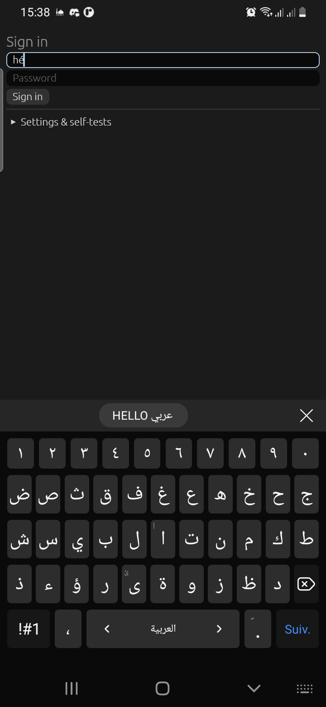
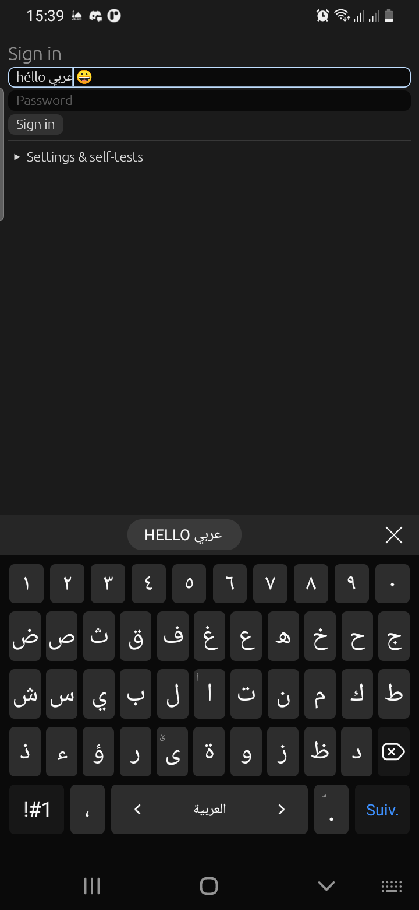
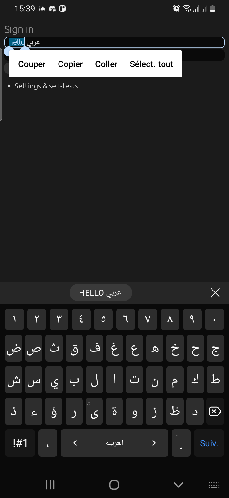
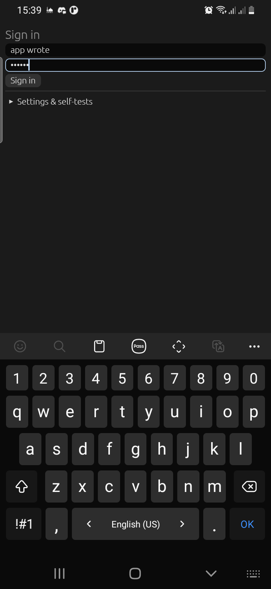
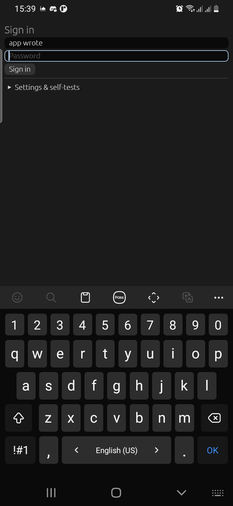

# On-device test report: 2026-11-11 15:39

## Summary

**13/13 checks pass** on a Galaxy A20 (Android 11, Samsung Keyboard), in 4 consecutive runs.
The automated test drives the real `InputConnection` the way a keyboard app does, then checks the
plain egui `TextEdit`. What the screenshots show:

- `05-arabic-emoji`: Latin with accents, Arabic and emoji in the field; the live Samsung keyboard on
  its Arabic layout, with Enter labelled "Suiv." (`EnterAction::Next`).
- `08-selection-handles-toolbar`: the selection, the two drag handles and the **floating
  Cut/Copy/Paste/Select-all toolbar** (system language: French).
- `17-password`: `FieldKind::Password` switches the keyboard into password mode (Latin layout,
  emoji/search disabled, Enter = "OK"), and the field is masked.
- `02-composing-underlined` is captured too late to show the underline: the screenshot over Wi-Fi
  takes ~1 s, and the live keyboard finishes a composition it didn't start. The underline has to be
  checked by hand with real typing.

## Bugs this test found (all fixed in this commit)

| Symptom | Root cause | Fix |
|---|---|---|
| `héhéllo`, the wrong character deleted, typing not replacing the selection | Two keyboard snapshots in one frame (the real keyboard reacting to the first): the second overwrote the replace-range before egui handled the edit | The adapter applies only the frame's **last** snapshot (each one is a whole state) |
| Floating toolbar never visible | The view hosting it was 1×1, then attached to the content area (y = 151 px) while the native surface covers the whole window: the selection rect fell outside the view, so Android hid the toolbar | The view covers the whole window (decor view) |
| Sometimes nothing typed at all (intermittent) | `Response::has_focus` also requires *window* focus; egui-winit can miss the window-focus event at startup on Android | The adapter uses widget focus (`memory.has_focus`), as TextEdit does |

Also measured: snapshot cost per keystroke ≈ 0.3 ms at 1k chars, 0.7–1.3 ms at 10k, 3–5 ms at 100k.


Device: SM-A205F, Android 11. Keyboard: `com.samsung.android.honeyboard/.service.HoneyBoardService`. oxydroid commit `7490e82` (+ working tree).
Run: `demo/autotest.sh`, which launches the demo with `--es oxytest 1`; steps in `demo/src/autotest.rs`.
Each step calls the real `InputConnection` the way a keyboard app does, then checks the egui field.

## Results
```
oxytest: PASS focus opens a keyboard session: focused=true
oxytest: PASS compose (é): "hé" (expected "hé")
oxytest: PASS commit replaces the composing word: "héllo" (expected "héllo")
oxytest: PASS Arabic + emoji: "héllo عربي 😀" (expected "héllo عربي 😀")
oxytest: PASS delete one code point (emoji = 2 UTF-16 units): "héllo عربي " (expected "héllo عربي ")
oxytest: PASS keyboard selection reaches egui: Some((0, 5))
oxytest: PASS typing replaces the selection: "HELLO عربي " (expected "HELLO عربي ")
oxytest: PASS select all + cut: "" (expected "")
oxytest: PASS paste (system clipboard): "HELLO عربي " (expected "HELLO عربي ")
oxytest: PASS app write reached the keyboard's mirror: "app wrote!" (expected "app wrote!")
oxytest: PASS DEL key event: "app wrote" (expected "app wrote")
oxytest: PASS password field gets text: 6 chars
race test: PASS (stale dropped: 2, RACE leaked: false, echo received: true)
latency: 1000 chars: 514 us per snapshot
latency: 10000 chars: 1038 us per snapshot
latency: 100000 chars: 4866 us per snapshot
oxytest: PASS race test (Q1): see race line
oxytest: DONE passed=13 failed=0
```

## Screenshots

### 02-composing-underlined



### 05-arabic-emoji



### 08-selection-handles-toolbar



### 17-password



### 99-results



Full log: [log.txt](log.txt)
