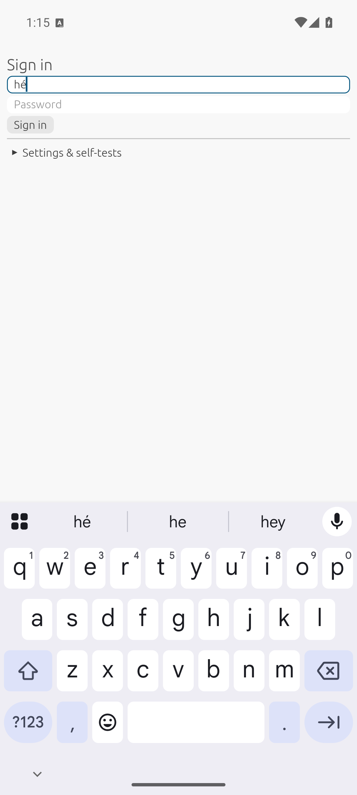
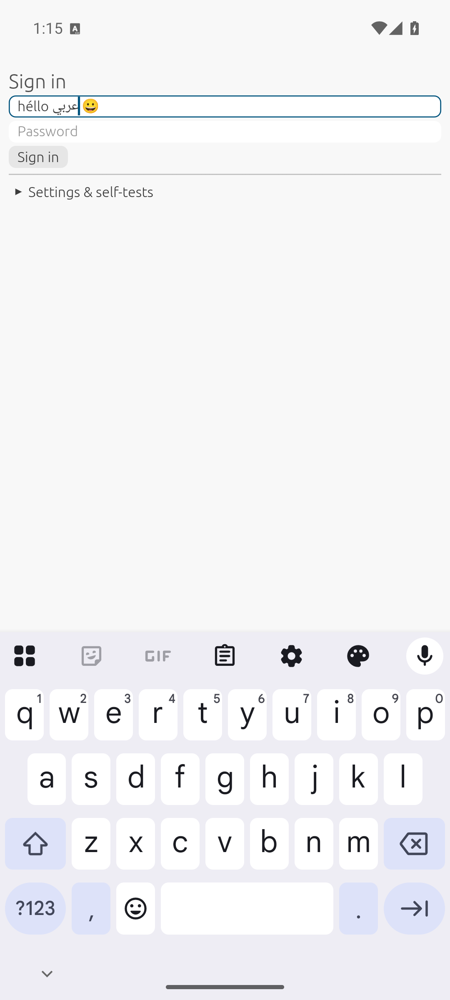
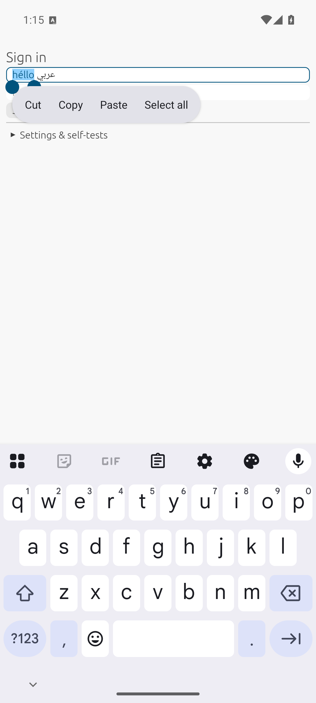
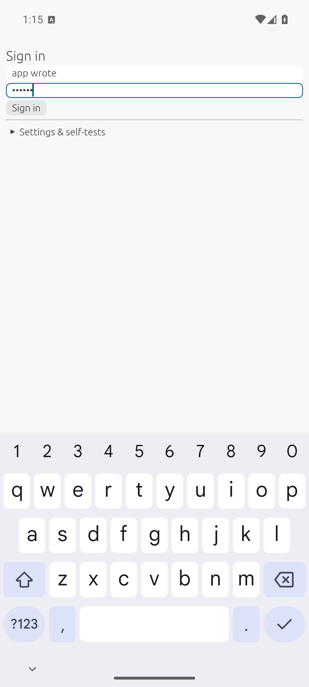

# On-device test report: 2026-11-14 12:15

## Summary

**14/14 checks pass** on the Android 16 emulator (API 36, x86_64, Google Play image) with **Gboard**,
the first run outside Samsung's keyboard. New since the A20 report: `getExtractedText` returns the
text and selection; Gboard's suggestion strip works through our `InputConnection`.

The first emulator run found two Android 16 bugs, **both fixed in this report's commit**:

| Symptom | Root cause | Fix |
|---|---|---|
| Status bar icons near-invisible (white on the light UI) | Android 16 forces edge-to-edge; nothing told the system the UI behind the bars is light | `set_light_system_bars`; the egui adapter follows the theme |
| Floating toolbar never visible (created, then destroyed within 50–450 ms) | Gboard answers a new selection with no-op calls (e.g. `finishComposingText()`); every keyboard call dismissed the toolbar | Only a real text change dismisses it, like `EditText` |

Screenshots: `05` shows the readable dark status bar icons; `08` the Cut/Copy/Paste/Select-all toolbar
in Android 16's style over the selection.


Device: sdk_gphone64_x86_64, Android 16. Keyboard: `com.google.android.inputmethod.latin/com.android.inputmethod.latin.LatinIME`. oxydroid commit `efa49e1` (+ working tree).
Run: `demo/autotest.sh`, which launches the demo with `--es oxytest 1`; steps in `demo/src/autotest.rs`.
Each step calls the real `InputConnection` the way a keyboard app does, then checks the egui field.

## Results
```
oxytest: PASS focus opens a keyboard session: focused=true
oxytest: PASS compose (é): "hé" (expected "hé")
oxytest: PASS commit replaces the composing word: "héllo" (expected "héllo")
oxytest: PASS Arabic + emoji: "héllo عربي 😀" (expected "héllo عربي 😀")
oxytest: PASS delete one code point (emoji = 2 UTF-16 units): "héllo عربي " (expected "héllo عربي ")
oxytest: PASS keyboard selection reaches egui: Some((0, 5))
oxytest: PASS typing replaces the selection: "HELLO عربي " (expected "HELLO عربي ")
oxytest: PASS select all + cut: "" (expected "")
oxytest: PASS paste (system clipboard): "HELLO عربي " (expected "HELLO عربي ")
oxytest: PASS app write reached the keyboard's mirror: "app wrote!" (expected "app wrote!")
oxytest: PASS DEL key event: "app wrote" (expected "app wrote")
latency: extracted=app wrote sel=9..9
oxytest: PASS getExtractedText returns the text and selection: Some("app wrote sel=9..9")
oxytest: PASS password field gets text: 6 chars
race test: PASS (stale dropped: 2, RACE leaked: false, echo received: true)
latency: 1000 chars: 88 us per snapshot
latency: 10000 chars: 108 us per snapshot
latency: 100000 chars: 1805 us per snapshot
oxytest: PASS race test (Q1): see race line
oxytest: DONE passed=14 failed=0
```

## Screenshots

### 02-composing-underlined



### 05-arabic-emoji



### 08-selection-handles-toolbar



### 17-password



### 99-results


Full log: [log.txt](log.txt)
