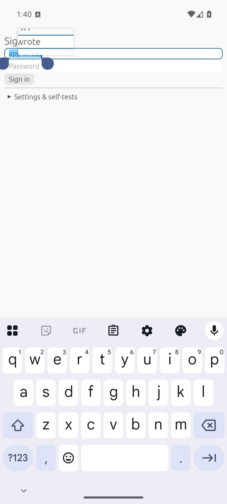
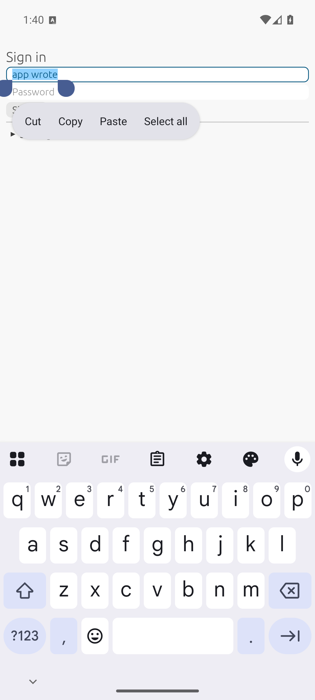

# On-device test report: 2026-11-14 12:40

## Summary

**18/18 checks pass** on the Android 16 emulator (API 36, x86_64, Google Play image) with **Gboard**.
Everything since the A20 report is covered: extracted text, Back, the keyboard slide animation, theme
info, and the native selection handles dragged with **real touches** from the test runner.

Screenshots:
- `05`: accents, Arabic, color emoji; dark, readable status bar icons under forced edge-to-edge.
- `08`: selection, the platform's own handles, and the floating toolbar placed so it doesn't cover them.
- `28`: mid-drag of the end handle: the **magnifier** shows the text around the caret.
- `30`: after the drag: the selection grew from "app" to "app wrote".

Found and fixed on the way (all in this commit range):

| Symptom | Root cause | Fix |
|---|---|---|
| Status bar icons near-invisible | Edge-to-edge (forced on 16) puts the app behind the bars; nothing said the UI is light | `set_light_system_bars`; the egui adapter follows the theme |
| Floating toolbar never visible with Gboard | Gboard's no-op calls after a selection dismissed it | Only a real text change dismisses it |
| Handles couldn't be grabbed | The toolbar was placed over them | Its target rect includes the handles, as in Android's text fields |
| Magnifier showed empty space | It followed the finger past the end of the text | Clamped to half a line around the caret |


Device: sdk_gphone64_x86_64, Android 16. Keyboard: `com.google.android.inputmethod.latin/com.android.inputmethod.latin.LatinIME`. oxydroid commit `8ac5832` (+ working tree).
Run: `demo/autotest.sh`, which launches the demo with `--es oxytest 1`; steps in `demo/src/autotest.rs`.
Each step calls the real `InputConnection` the way a keyboard app does, then checks the egui field.

## Results
```
oxytest: PASS focus opens a keyboard session: focused=true
oxytest: PASS compose (é): "hé" (expected "hé")
oxytest: PASS commit replaces the composing word: "héllo" (expected "héllo")
oxytest: PASS Arabic + emoji: "héllo عربي 😀" (expected "héllo عربي 😀")
oxytest: PASS delete one code point (emoji = 2 UTF-16 units): "héllo عربي " (expected "héllo عربي ")
oxytest: PASS keyboard selection reaches egui: Some((0, 5))
oxytest: PASS typing replaces the selection: "HELLO عربي " (expected "HELLO عربي ")
oxytest: PASS select all + cut: "" (expected "")
oxytest: PASS paste (system clipboard): "HELLO عربي " (expected "HELLO عربي ")
oxytest: PASS app write reached the keyboard's mirror: "app wrote!" (expected "app wrote!")
oxytest: PASS DEL key event: "app wrote" (expected "app wrote")
latency: extracted=app wrote sel=9..9
oxytest: PASS getExtractedText returns the text and selection: Some("app wrote sel=9..9")
oxytest: PASS password field gets text: 6 chars
race test: PASS (stale dropped: 2, RACE leaked: false, echo received: true)
latency: 1000 chars: 76 us per snapshot
latency: 10000 chars: 100 us per snapshot
latency: 100000 chars: 2269 us per snapshot
oxytest: PASS Back reaches the app (OnBackInvokedCallback): API 36
oxytest: PASS dragging the native end handle extends the selection: Some((0, 9))
oxytest: PASS race test (Q1): see race line
oxytest: PASS keyboard slide arrives frame by frame: 38 distinct heights, max Some(883) px
oxytest: PASS theme info: accent color + animations: Some(("#FF475D92", true))
oxytest: DONE passed=18 failed=0
```

## Screenshots

### 02-composing-underlined


### 05-arabic-emoji


### 08-selection-handles-toolbar


### 17-password


### 28-handle-drag-magnifier



### 30-after-handle-drag



### 99-results


Full log: [log.txt](log.txt)
