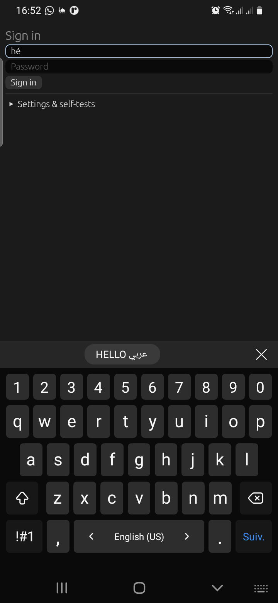
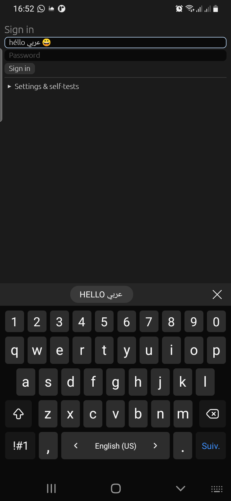
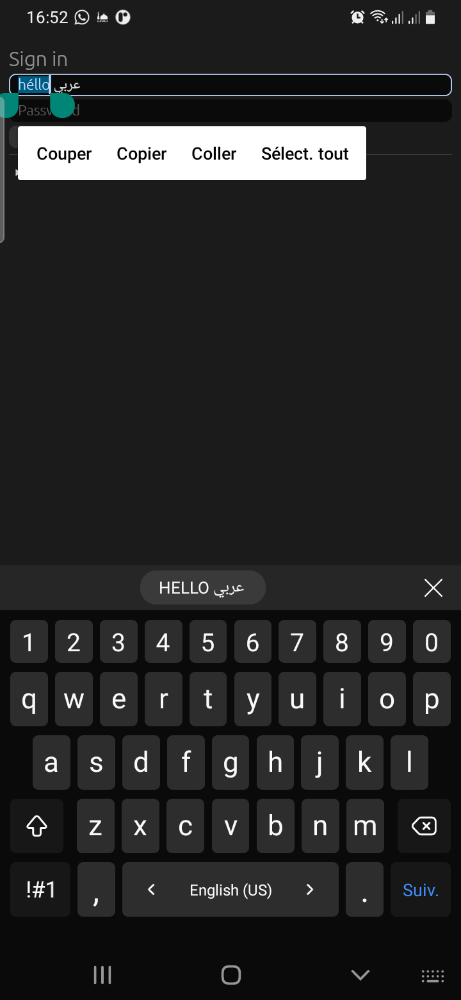
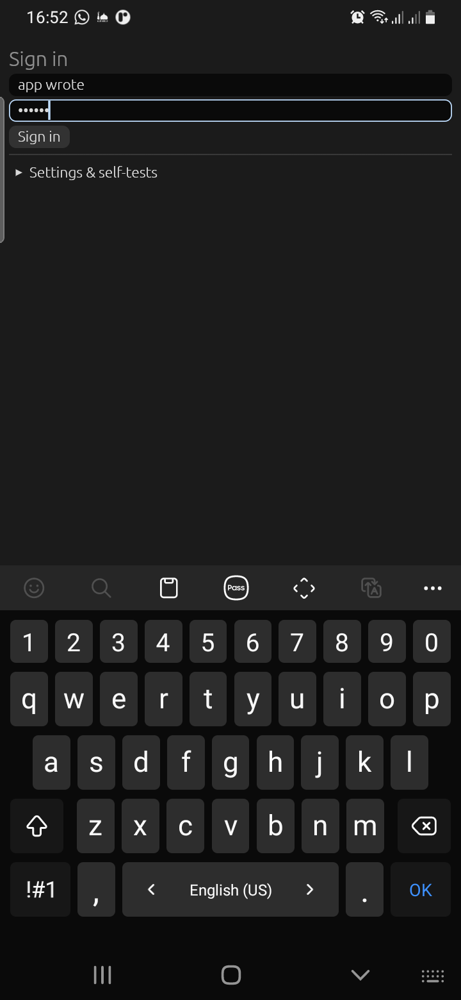
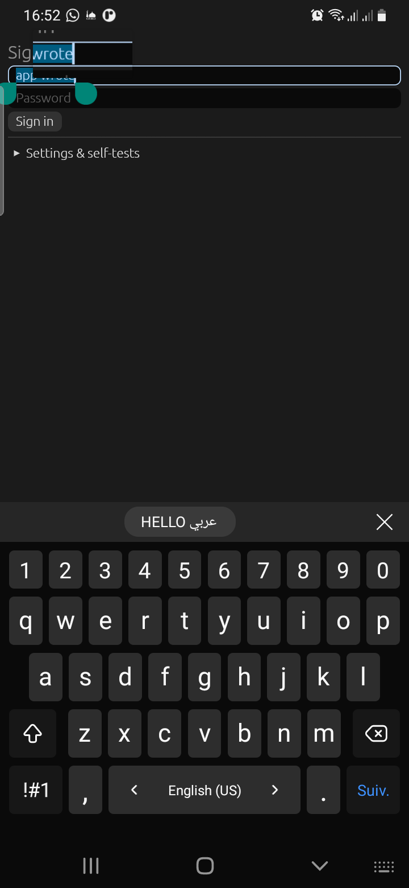
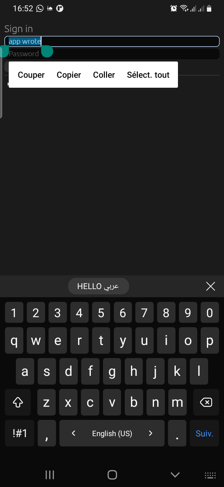

# On-device test report: 2026-11-14 16:52

## Summary

**17/17 checks pass** on the Galaxy A20 (Android 11, One UI 3, Samsung Keyboard): everything added
since the first A20 report (2026-11-11) now verified on a real phone with Samsung's keyboard.
Back is skipped (needs Android 13+; verified on the Android 16 emulator).

- `08`: native handles in **Samsung's teal** (they're the platform's drawables, so they follow the
  system theme), and the Cut/Copy/Paste toolbar placed below them, not over them.
- `28`: the magnifier during a real-touch handle drag, showing "wrote".

Found on this run: the keyboard slide arrived as only 2 heights (0 and 678 px). Android sends the
IME animation frame by frame only to apps that draw **edge-to-edge**; otherwise it just resizes
the window. With `set_edge_to_edge(true)` the A20 delivers **44 frames**. (Android 15+ forces
edge-to-edge at target 35+, which is why the Android 16 emulator showed it without asking.)
The test now enables edge-to-edge below API 35.


Device: SM-A205F, Android 11. Keyboard: `com.samsung.android.honeyboard/.service.HoneyBoardService`. oxydroid commit `d3a5242` (+ working tree).
Run: `demo/autotest.sh`, which launches the demo with `--es oxytest 1`; steps in `demo/src/autotest.rs`.
Each step calls the real `InputConnection` the way a keyboard app does, then checks the egui field.

## Results
```
oxytest: PASS focus opens a keyboard session: focused=true
oxytest: PASS compose (é): "hé" (expected "hé")
oxytest: PASS commit replaces the composing word: "héllo" (expected "héllo")
oxytest: PASS Arabic + emoji: "héllo عربي 😀" (expected "héllo عربي 😀")
oxytest: PASS delete one code point (emoji = 2 UTF-16 units): "héllo عربي " (expected "héllo عربي ")
oxytest: PASS keyboard selection reaches egui: Some((0, 5))
oxytest: PASS typing replaces the selection: "HELLO عربي " (expected "HELLO عربي ")
oxytest: PASS select all + cut: "" (expected "")
oxytest: PASS paste (system clipboard): "HELLO عربي " (expected "HELLO عربي ")
oxytest: PASS app write reached the keyboard's mirror: "app wrote!" (expected "app wrote!")
oxytest: PASS DEL key event: "app wrote" (expected "app wrote")
latency: extracted=app wrote sel=9..9
oxytest: PASS getExtractedText returns the text and selection: Some("app wrote sel=9..9")
oxytest: PASS password field gets text: 6 chars
race test: PASS (stale dropped: 2, RACE leaked: false, echo received: true)
latency: 1000 chars: 1195 us per snapshot
latency: 10000 chars: 1660 us per snapshot
latency: 100000 chars: 3999 us per snapshot
oxytest: PASS dragging the native end handle extends the selection: Some((0, 9))
oxytest: PASS race test (Q1): see race line
oxytest: PASS keyboard slide arrives frame by frame: 44 distinct heights, max Some(678) px
oxytest: PASS theme info: accent color + animations: Some(("#FF008577", true))
oxytest: DONE passed=17 failed=0
```

## Screenshots

### 02-composing-underlined



### 05-arabic-emoji



### 08-selection-handles-toolbar



### 17-password



### 28-handle-drag-magnifier



### 30-after-handle-drag



### 99-results


Full log: [log.txt](log.txt)
